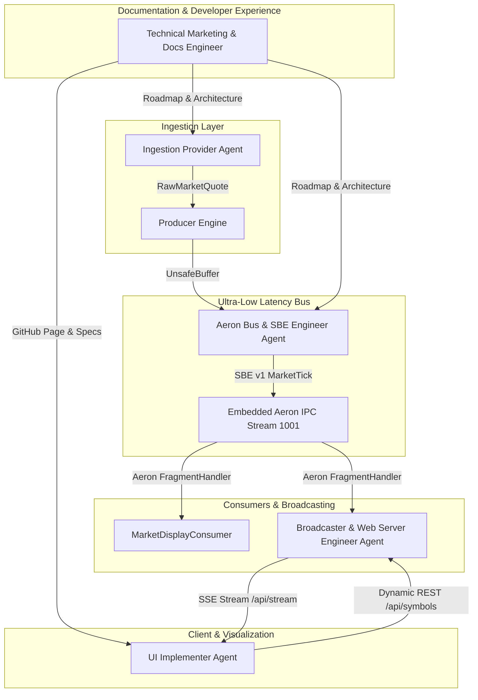

# Multi-Agent Architecture & Engineering Roster

`track-my-market` was designed, constructed, and optimized using a specialized multi-agent autonomous engineering workflow. Each agent operated within strict architectural boundaries, adhering to interface contracts, automated verification suites, and zero-allocation performance principles.

This document details the responsibilities, protocols, interface boundaries, and collaboration workflows of the engineering agents powering `track-my-market`.

---

## High-Level Agent Collaboration Topology



---

## 1. Specialized Agent Roster

### 1.1 Ingestion Provider Agent
- **Domain**: Resilient HTTP market data extraction, session credential negotiation, and upstream payload sanitization.
- **Key Modules**:
  - [`YahooFinanceProvider.java`](file:///C:/Workspace/git/track-my-market/src/main/java/market/provider/yahoo/YahooFinanceProvider.java)
  - [`MarketDataProvider.java`](file:///C:/Workspace/git/track-my-market/src/main/java/market/provider/MarketDataProvider.java)
  - [`RawMarketQuote.java`](file:///C:/Workspace/git/track-my-market/src/main/java/market/provider/RawMarketQuote.java)
- **Key Responsibilities**:
  - **No-KYC / No-Demat Ingestion**: Implemented a public web adapter bypassing the need for paid broker APIs, static IP whitelisting, or KYC document submissions.
  - **Crumb & Cookie Recycling**: Automated extraction of Yahoo Finance ephemeral cookies (`A3` session token) and dynamic cryptographic crumb retrieval to authenticate REST requests.
  - **Deduplication Engine**: Integrated a per-symbol timestamp and price cache to suppress redundant network quotes before injecting them into the Aeron ring buffer.
  - **Search Autocomplete**: Implemented the multi-exchange symbol search resolver (`query1.finance.yahoo.com/v1/finance/search`) with support for NSE/BSE securities, ISIN, and SEDOL inference.
  - **Delisted Alias Handling**: Resilient ticker translation (e.g. `TMPV.NS`, `TMCV.NS`, `TATAMOTORS.NS`) with intelligent fallback warnings and suggestion banners.

---

### 1.2 Aeron Bus & SBE Engineer Agent
- **Domain**: Mechanical sympathy, off-heap memory management, zero-allocation serialization, and nanosecond inter-process communication.
- **Key Modules**:
  - [`market-data-schema.xml`](file:///C:/Workspace/git/track-my-market/src/main/resources/market-data-schema.xml)
  - [`AeronEventBus.java`](file:///C:/Workspace/git/track-my-market/src/main/java/market/bus/aeron/AeronEventBus.java)
  - [`MarketEventBus.java`](file:///C:/Workspace/git/track-my-market/src/main/java/market/bus/MarketEventBus.java)
  - Generated SBE Stubs (`market.sbe.MarketTickEncoder`, `market.sbe.MarketTickDecoder`, `market.sbe.MessageHeaderEncoder`)
- **Key Responsibilities**:
  - **Simple Binary Encoding (SBE v1)**: Defined the binary schema packing prices into scaled `uint64` (factor $10^4$), nanosecond timestamps (`int64`), and fixed-width strings for symbol (`fixedString16`), ISIN (`fixedString12`), SEDOL (`fixedString7`), and RIC (`fixedString16`). Total payload footprint: 64 bytes.
  - **Off-Heap Direct Memory**: Utilized Agrona `UnsafeBuffer` backed by direct byte buffers, guaranteeing 0 bytes of heap garbage generated during serialization and deserialization.
  - **Embedded Aeron Media Driver**: Orchestrated Real Logic Aeron with an embedded `ArchivingMediaDriver` utilizing POSIX shared memory ring buffers (`/dev/shm`), enabling sub-microsecond (< 1 µs) message transfer between publisher and subscribers.
  - **Lock-Free Polling**: Configured lock-free publication backpressure handling and non-blocking `Subscription.poll(fragmentHandler, fragmentLimit)`.

---

### 1.3 Broadcaster & Web Server Engineer Agent
- **Domain**: High-concurrency transport bridging, Server-Sent Events (SSE), and non-blocking Java 25 HTTP serving.
- **Key Modules**:
  - [`MarketStreamBroadcaster.java`](file:///C:/Workspace/git/track-my-market/src/main/java/market/web/MarketStreamBroadcaster.java)
  - [`MarketHttpServer.java`](file:///C:/Workspace/git/track-my-market/src/main/java/market/web/MarketHttpServer.java)
  - [`DynamicWatchlistController.java`](file:///C:/Workspace/git/track-my-market/src/main/java/market/web/DynamicWatchlistController.java)
- **Key Responsibilities**:
  - **IPC-to-SSE Bridge**: Implemented `MarketStreamBroadcaster` which registers an Aeron subscriber, decodes incoming `MarketTick` frames, and fans out JSON events to active web browser sessions.
  - **Initial Snapshot & Jitter Mitigation**: Cached the latest quote for every monitored symbol so newly connected browser clients immediately receive a full market snapshot before the next poll cycle.
  - **Java 25 Virtual Threads**: Configured `Executors.newVirtualThreadPerTaskExecutor()` for the embedded `HttpServer`, allowing thousands of simultaneous streaming client connections with negligible CPU overhead.
  - **Dynamic Symbol Management**: Built REST endpoints (`/api/symbols`, `/api/search`) allowing users to add or remove ticker symbols at runtime, triggering immediate on-demand quote fetches.

---

### 1.4 UI Implementer Agent
- **Domain**: Professional high-frequency trading desk ergonomics, micro-interactions, responsive charts, and real-time visualization.
- **Key Modules**:
  - [`index.html` (Web Desk)](file:///C:/Workspace/git/track-my-market/src/main/resources/web/index.html)
- **Key Responsibilities**:
  - **Dark-Slate HFT Aesthetic**: Engineered a high-contrast dark theme (`#0b0f19` base, `#0f172a` panel, `#38bdf8` cyan, `#10b981` emerald, `#f43f5e` crimson) with monospace tabular numeral alignments (`JetBrains Mono`).
  - **TradingView Lightweight Charts v4 Integration**: Embedded financial charting displaying real-time price updates, responsive canvas rendering, and crosshair metrics tracking.
  - **Live Telemetry HUD**: Exposed instant diagnostic badges for network fetch latency, Aeron IPC bus transit time (in microseconds), tick volume counters, and subscription states.
  - **Live Search Autocomplete**: Created a debounce-driven search bar querying backend ticker databases, displaying company names, exchange badges (`NSE`, `BSE`, `US`), and quick-preset action chips.
  - **Price Flash Feedback**: Visual green/red background highlight flashes on price updates for instantaneous optical recognition of market volatility.

---

### 1.5 Technical Marketing & Documentation Engineer Agent
- **Domain**: Developer advocacy, technical writing, interactive promotional pages, benchmark synthesis, and multi-agent coordination.
- **Key Modules**:
  - [`docs/index.html`](file:///C:/Workspace/git/track-my-market/docs/index.html) (Promotional Showcase & Interactive Terminal Simulator)
  - [`docs/AGENTS.md`](file:///C:/Workspace/git/track-my-market/docs/AGENTS.md) (This Architecture & Governance Guide)
  - [`docs/ROADMAP.md`](file:///C:/Workspace/git/track-my-market/docs/ROADMAP.md) (Engineering Milestones & Phase Checklists)
- **Key Responsibilities**:
  - Designed an ultra-modern, standalone GitHub Page showcasing live simulated quote feeds, nanosecond Aeron telemetry, and interactive timeframe previews.
  - Authored comprehensive architectural documentation outlining zero-allocation data structures, latency benchmarks, and containerized deployment paths.
  - Formulated the phase-by-phase implementation roadmap for alerts, Prometheus metrics, multi-broker adapters, and options Greeks analytics.

---

## 2. Agent Operational Protocols

### Protocol 1: Interface-Driven Development
All agents develop against abstract interfaces before implementing concrete classes:
- Producers write only to `MarketEventBus`.
- Ingestion services implement `MarketDataProvider`.
- Web controllers consume `DynamicWatchlistController` and `MarketStreamBroadcaster`.
This allows mocking, standalone unit testing, and hot-swapping components without regressions.

### Protocol 2: Zero-Allocation Off-Heap Guarantee
Any modification to the message serialization pipeline must maintain zero-allocation invariant in the hot path:
- No `new` object allocations inside `onFragment` or `publishTick`.
- Flyweight encoders and decoders must be reused via thread-local or instance caching (`wrap(directBuffer, offset)`).
- Timestamps must remain primitive `long` nanoseconds; prices must remain primitive scaled `long`.

### Protocol 3: Automated Verification Before Completion
Before marking any task complete, agents execute end-to-end verification:
```powershell
./gradlew test
docker compose config
```
All unit tests, schema generation tasks, and integration sanity checks must pass cleanly.

---

## 3. Communication Artifacts & Handoffs

| Producing Agent | Consuming Agent | Primary Artifact / Contract |
| :--- | :--- | :--- |
| **Ingestion Provider** | **Aeron Bus Engineer** | `RawMarketQuote` records with high-resolution epoch nanoseconds |
| **Aeron Bus Engineer** | **Broadcaster Agent** | SBE `MarketTickDecoder` & Aeron `Subscription` channel `aeron:ipc?stream-id=1001` |
| **Broadcaster Agent** | **UI Implementer** | SSE event stream `/api/stream` emitting structured JSON quotes |
| **UI Implementer** | **Documentation Agent** | Live web desk layout, DOM element hooks, and telemetry metrics |
| **Documentation Agent** | **Community & Users** | GitHub Pages terminal showcase, quickstarts, and technical roadmap |
