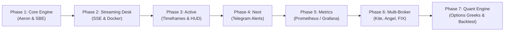
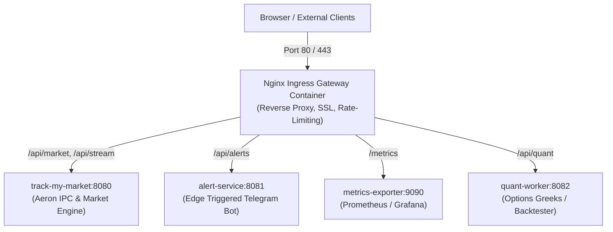

# Project Roadmap & Engineering Milestones

This document outlines the evolutionary roadmap for **`track-my-market`**, tracing progress from the initial high-throughput Aeron/SBE core to real-time charting, edge-triggered algorithmic alerting, observability metrics, multi-broker connectivity, and high-frequency quantitative analytics.

---

## High-Level Phase Overview



---

## Phase Status Summary

| Phase | Title | Focus Area | Status | Target Timeline |
| :---: | :--- | :--- | :---: | :---: |
| **1** | Core Ingestion & Aeron Bus | SBE v1 schema, Embedded Aeron IPC, Yahoo Adapter | **Completed** | Q3 2026 |
| **2** | Web Trading Desk & Deployment | SSE broadcaster, Lightweight Charts v4, Nginx | **Completed** | Q4 2026 |
| **3** | Interactive Timeframes & Market Status | Custom resolutions, crosshair HUD, exchange clock | **In Progress** | Current |
| **4** | Edge-Triggered Telegram Alert Engine | State machine, threshold crossings, rate-limiting | **Upcoming** | Sprint 1 2027 |
| **5** | Observability & Prometheus Exporter | `/metrics`, latency quantiles, Grafana dashboard | **Planned** | Sprint 2 2027 |
| **6** | Multi-Broker & FIX Protocol Adapters | Zerodha Kite, Angel One SmartAPI, IBKR FIX | **Planned** | Q2 2027 |
| **7** | Options Greeks & Strategy Backtester | Black-Scholes, IV surface, algorithmic backtester | **Planned** | Q3 2027 |

---

## Detailed Phase Breakdown & Tasks

### Phase 1: Core Ingestion & Aeron SBE Engine (Completed)
- [x] **SBE Schema v1 Specification**: Define `market-data-schema.xml` with scaled integer prices (`uint64`), epoch nanoseconds (`int64`), and fixed-width fields (`fixedString16` symbol, `fixedString12` ISIN, `fixedString7` SEDOL, `fixedString16` RIC).
- [x] **Gradle Build Automation**: Configure `sbe-all` toolchain to compile binary encoders and decoders into Java stubs during `compileJava`.
- [x] **Embedded Archiving Media Driver**: Integrate Real Logic Aeron with embedded media driver, POSIX shared memory ring buffers (`/dev/shm`), and IPC channel (`aeron:ipc?stream-id=1001`).
- [x] **Resilient Ingestion Adapter**: Public Yahoo Finance provider with automated cookie (`A3`) and cryptographic crumb session negotiation.
- [x] **Deduplication Engine**: Discard duplicate ticks based on symbol timestamps to avoid unnecessary bus churn.
- [x] **Console Telemetry Consumer**: Terminal display formatting price changes, transit latency, and provider identification.

---

### Phase 2: Streaming Web Desk & Raw Containerization (Completed)
- [x] **Aeron-to-SSE Bridge**: Implemented `MarketStreamBroadcaster` that subscribes to the Aeron bus and multicasts JSON ticks over Server-Sent Events.
- [x] **Virtual Thread HTTP Server**: Embedded Java 25 `HttpServer` with `Executors.newVirtualThreadPerTaskExecutor()` handling concurrent SSE subscribers directly on port 8080.
- [x] **Dynamic Watchlist REST API**: Endpoints (`GET /api/symbols`, `POST /api/symbols`, `DELETE /api/symbols/{sym}`, `GET /api/search`, `GET /api/fx`) for runtime ticker and currency management.
- [x] **TradingView Lightweight Charts v4**: Real-time candlestick and area charting with smooth updates, dynamic resizing, custom timezone tick formatters, and FX currency conversion.
- [x] **Raw Standalone Docker Containerization**: Self-contained multi-stage Dockerfile and lightweight `docker-compose.yml` with 512MB shared memory allocation (`shm_size: 512m`) for Aeron IPC ring buffers, running raw on port 8080 without external proxy dependencies.

---

### Phase 3: Interactive Timeframes & Market Status HUD (Current)
*Targeting seamless intraday and multi-year analysis directly from the web terminal.*

- [ ] **Custom Timeframe Selector**:
  - [x] Interactive UI buttons: `1H`, `3H`, `6H`, `12H`, `1D`, `3D`, `1W`, `1M`, `6M`, `1Y`, `3Y`, `5Y`, `ALL`.
  - [ ] Provider historical data resolution mapping:
    - `1H` / `3H` / `6H` -> 1-minute intraday intervals (`interval=1m`).
    - `1D` / `3D` -> 5-minute intervals (`interval=5m`).
    - `1W` / `1M` -> 15-minute / 1-hour intervals (`interval=1h`).
    - `6M` / `1Y` / `5Y` / `ALL` -> 1-day candles (`interval=1d`).
  - [ ] Seamless chart series clearing and historical candle backfilling upon timeframe change.
- [ ] **Real-Time Crosshair Metrics HUD**:
  - [x] Interactive mouse-tracking crosshair on Lightweight Charts.
  - [ ] Floating HUD displaying Open, High, Low, Close, Volume (OHLCV), price percentage differential from session open, and point-in-time Aeron transit latency.
- [ ] **Tradable Exchange Status Indicator**:
  - [ ] Dynamic market clock tracking National Stock Exchange (NSE) and Bombay Stock Exchange (BSE) trading sessions:
    - Pre-Open Session: `09:00 - 09:15 IST` (Amber indicator).
    - Regular Trading Session: `09:15 - 15:30 IST` (Emerald Green pulsing indicator).
    - Closing Session: `15:30 - 16:00 IST` (Sky Blue indicator).
    - Market Closed / Weekend / Exchange Holiday: (Dark Red / Muted indicator with countdown to next open).
  - [ ] Visual badge reflecting realtime market state in header navigation bar.
- [ ] **Search Autocomplete Enhancements**:
  - [x] Debounced search query input.
  - [x] Multi-exchange symbol search with NSE/BSE badges.
  - [ ] Client-side recent search cache with keyboard navigation (`ArrowUp`, `ArrowDown`, `Enter`).

---

### Phase 4: Edge-Triggered Telegram Alert Engine (Next)
*High-reliability notifications triggered on threshold crossings with stateful edge detection.*

- [ ] **Alert Rule Specification**:
  - Configurable alert trigger conditions:
    - `PRICE_ABOVE`: Triggers when current price crosses strictly above target threshold $P_t$.
    - `PRICE_BELOW`: Triggers when current price crosses strictly below target threshold $P_t$.
    - `PERCENT_CHANGE_SPIKE`: Triggers when 5-minute volatility exceeds threshold $\Delta\%$.
    - `VOLUME_BURST`: Triggers when volume spike exceeds $N \times$ 20-period moving average.
- [ ] **State Machine & Edge Detection**:
  ```mermaid
  stateDiagram-v2
      [*] --> ARMED
      ARMED --> TRIGGERED: Threshold Crossed
      TRIGGERED --> COOLDOWN: Dispatch Telegram Notification
      COOLDOWN --> ARMED: Cooldown Elapsed & Price Reset
  ```
  - State `ARMED`: Listening to live Aeron stream.
  - State `TRIGGERED`: Edge crossing confirmed; generates alert payload.
  - State `COOLDOWN`: Enforces configurable suppression window (e.g., 10 minutes) to eliminate alert spam during price oscillations around threshold boundaries.
- [ ] **Telegram Bot Dispatcher**:
  - Asynchronous Java 25 HTTP client pushing rich markdown messages:
    ```
    🚨 [ALERT TRIGGERED] RELIANCE.NS
    Target: ₹ 1,420.00 | Actual: ₹ 1,422.30 (+1.85%)
    Timestamp: 2027-01-14 11:24:02 IST
    Aeron Bus Transit: 420 ns
    ```
  - Secure configuration via environment variables (`TELEGRAM_BOT_TOKEN`, `TELEGRAM_CHAT_ID`).

---

### Phase 5: Observability & Prometheus Exporter
*Production telemetry and diagnostic visibility for HFT operations.*

- [ ] **Embedded Prometheus Metrics Exporter (`/metrics`)**:
  - Standard Prometheus OpenMetrics format served over HTTP.
- [ ] **Core Telemetry Gauges & Histograms**:
  - `market_fetch_duration_seconds{provider="yahoo",symbol="..."}`: Network RTT histogram with percentiles (p50, p90, p99).
  - `aeron_bus_transit_latency_nanoseconds`: End-to-end IPC latency from ingress timestamp to consumer reception.
  - `market_ticks_total{symbol="...",provider="..."}`: Counter tracking aggregate processed ticks.
  - `aeron_ring_buffer_backpressure_total`: Counter for publication backpressure events.
  - `active_sse_connections`: Gauge tracking connected web clients.
- [ ] **Grafana Dashboard Template**:
  - Out-of-the-box JSON dashboard model featuring latency heatmaps, tick ingestion throughput, and system memory allocations.

---

### Phase 6: Multi-Broker & Direct FIX Protocol Adapters
*Expanding beyond web scrapers to official low-latency broker APIs and FIX gateways.*

- [ ] **Zerodha Kite Connect WebSocket Adapter**:
  - Binary packet decoding of Zerodha 1-tick/second WebSocket feeds.
  - Direct conversion into SBE `MarketTick` representation.
- [ ] **Angel One SmartAPI Adapter**:
  - Binary WebSocket market stream ingestion with auto-reconnect and token refresh.
- [ ] **Dhan HQ Market Data Feed**:
  - Real-time quote streaming via Dhan API v2.
- [ ] **Interactive Brokers (IBKR) FIX Protocol Gateway**:
  - FIX 4.2 / 4.4 Financial Information eXchange message parser.
  - Off-heap tag-value decoding directly mapped into Aeron ring buffers.
- [ ] **Dynamic Provider Failover**:
  - Automatic fallback to secondary provider if primary stream disconnects or exceeds 5,000ms latency.

---

### Phase 7: Real-Time Options Greeks & Quantitative Backtester
*Institutional-grade quantitative analytics calculated per-tick.*

- [ ] **Options Chain Ingestion**:
  - Real-time ingestion of NIFTY and BANKNIFTY strike tables (Calls & Puts).
- [ ] **Greeks Calculation Engine**:
  - High-performance, zero-allocation Black-Scholes analytical pricer.
  - Greeks evaluation:
    - **Delta** ($\Delta$): Hedge ratio / directional exposure.
    - **Gamma** ($\Gamma$): Rate of change of Delta.
    - **Vega** ($\mathcal{V}$): Sensitivity to Implied Volatility.
    - **Theta** ($\Theta$): Daily time decay.
    - **Rho** ($\rho$): Interest rate sensitivity.
  - Implied Volatility solver using vectorized Newton-Raphson iterations.
- [ ] **Strategy Backtester**:
  - Replay historical Aeron archive recordings (`AeronArchive`).
  - Deterministic tick-by-tick simulation of order execution with customizable slippage models.

---

### Architectural Design Note: Multi-Container Ingress Gateway (Planned Future Phase)
*Noted for future implementation when transitioning to a distributed microservice mesh.*

When scaling to multiple independent service containers, a dedicated Nginx ingress container will be introduced as the single entrypoint gateway:

- **Current State:** `track-my-market` runs standalone and raw on port `8080` without an extra Nginx container wrapper.
- **Future State:** An isolated Nginx container will handle multi-service routing, SSL termination, path rewriting, and load balancing across all backend microservice containers once the ecosystem expands.
