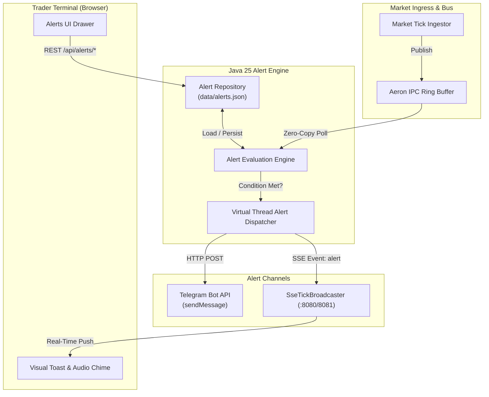

# Rule-Based Alerting & Telegram Notification Engine Design

- **Date:** 2026-11-06
- **Author:** Abhishek Raha & AI Assistant
- **Status:** Draft (Pending User Approval)
- **Topic:** Rule-Based Alerting System with UI Configuration & Telegram Dispatch

---

## 1. Intent & Context

Track My Market streams low-latency financial market data over Real Logic Aeron IPC and zero-allocation SBE v1, serving real-time quotes to a TradingView Lightweight Charts trading desk. Traders monitoring market action require automated notifications when target price levels are breached without needing to watch the screen constantly.

The goal of this project is to build an extensible, server-side, rule-based alerting engine that allows users to create price threshold rules (Above / Below) directly from the UI, supports One-Shot and Recurring (with Cooldown) triggers, sounds an in-browser audio chime and toast notification, and dispatches instant alert messages to a configured Telegram chat or channel.

---

## 2. Goals, Non-Goals, and Anti-Goals

### Goals
- **Server-Side 24/7 Evaluation**: Rules evaluate against the streaming tick flow in the Java engine so alerts fire and Telegram notifications dispatch even if no browser client is open.
- **Flexible Trigger Modes**: Support both:
  - **One-Shot**: Fires once when the threshold is crossed and automatically deactivates until re-armed by the user.
  - **Recurring with Cooldown**: Fires on cross and remains active, but respects a user-configured cooldown window (e.g., 5 min, 15 min, 30 min, 60 min) before notifying again if the price remains breached.
- **Multi-Channel Dispatch**:
  - **Browser UI**: Real-time Server-Sent Events (`event: alert`) triggering an animated visual toast, active counter badge, and synthesized Web Audio chime.
  - **Telegram Bot**: Asynchronous message dispatch to a configured Telegram bot and target chat/channel.
- **Interactive UI Management**: Intuitive Alerts drawer in the trading desk to create rules, view active/triggered rules, browse history logs, and test/configure Telegram credentials.
- **Safe Persistence**: Save active rules and triggered logs to a local JSON file (`data/alerts.json`) so user alerts survive container/application restarts.
- **Zero-Latency Ingress Impact**: Telegram network calls and file I/O must run asynchronously on Java 25 Virtual Threads, ensuring zero blockage of the Aeron IPC ring buffer.

### Non-Goals
- Complex multi-indicator algorithmic rules (e.g., "RSI(14) > 70 AND MACD cross") in this phase; alerts are strictly price threshold rules (`Price >= Target` or `Price <= Target`).
- Multi-user authentication / RBAC; the system runs as a single-trader or team desk deployment.

### Anti-Goals
- **No Client-Side-Only Alerting**: Relying on the browser JavaScript to evaluate alerts is strictly forbidden, as closing the browser tab would silently kill external Telegram notifications.
- **No Blocking Network Calls on Aeron Poller**: Never perform synchronous HTTP calls to Telegram inside an Aeron `FragmentHandler` or polling loop.

---

## 3. Approaches Considered & Selected

### Approach 1: Dedicated Aeron-Native Alert Engine (Selected)
- **Architecture**: A dedicated `AlertRuleEngine` subscribed to the Aeron IPC stream or integrated into the tick distribution flow. When a decoded tick arrives, active rules for that symbol are evaluated off-heap. When triggered, the engine spawns Java 25 Virtual Threads (`Thread.ofVirtual()`) to dispatch Telegram HTTP requests and emit SSE alert events to browser clients.
- **Why Selected**: Fully preserves the mechanical-sympathetic, decoupled Aeron architecture. High evaluation throughput with zero latency impact on market ingestion.

### Approach 2: Broadcast-Hook Alert Manager
- **Architecture**: Evaluate rules inside `SseTickBroadcaster` before emitting SSE lines.
- **Trade-off**: Simpler wiring, but couples alerting business logic directly to web presentation code rather than keeping it as an event-driven domain service.

### Approach 3: Client-Side Evaluation with Server Webhook Proxy
- **Architecture**: Browser JavaScript checks prices and calls a server webhook endpoint.
- **Trade-off**: Discarded because closing the browser laptop kills all alerting and Telegram delivery.

---

## 4. System Architecture & Components



---

## 5. Detailed Component Specifications

### 5.1. Data Models (`market.alert`)

```java
public record AlertRule(
    String id,                     // UUID string
    String symbol,                 // e.g., "RELIANCE.NS", "AAPL"
    AlertCondition condition,      // ABOVE, BELOW
    double targetPrice,            // Trigger threshold
    TriggerMode triggerMode,       // ONE_SHOT, RECURRING
    int cooldownMinutes,           // Cooldown duration if RECURRING (e.g. 5, 15, 60)
    boolean notifyTelegram,        // Toggle for Telegram channel
    boolean notifyUi,              // Toggle for UI chime/toast
    AlertStatus status,            // ACTIVE, TRIGGERED, DISABLED
    double referencePrice,         // Price at rule creation to detect genuine crossing
    long lastTriggeredAtEpochMs,   // Timestamp of last execution
    long createdAtEpochMs          // Creation timestamp
) {}

public enum AlertCondition {
    ABOVE,  // Price crosses to >= targetPrice
    BELOW   // Price crosses to <= targetPrice
}

public enum TriggerMode {
    ONE_SHOT,   // Fires once, transitions status to TRIGGERED
    RECURRING   // Fires, respects cooldownMinutes before firing again
}

public enum AlertStatus {
    ACTIVE,
    TRIGGERED,
    DISABLED
}

public record AlertEvent(
    String alertId,
    String symbol,
    AlertCondition condition,
    double targetPrice,
    double triggerPrice,
    long timestampEpochMs,
    String message
) {}

public record TelegramConfig(
    String botToken,
    String chatId,
    boolean enabled
) {}
```

### 5.2. `AlertRepository` & Symbol Lifecycle
- **Location**: `src/main/java/market/alert/AlertRepository.java`
- Thread-safe storage using `ConcurrentHashMap<String, AlertRule>`.
- **Auto-Subscription Lifecycle**: When an alert rule is created (or loaded on startup from `data/alerts.json`), the system verifies that `symbol` is subscribed in `MarketDataProvider`. If not currently subscribed, it automatically subscribes it (`provider.subscribe(List.of(symbol))`) so price ticks are actively ingested from exchange feeds.
- **Persistence & Security**: Persists rules and Telegram settings to `data/alerts.json` (with `data/` added to `.gitignore` to prevent credential leakage).
- **Configuration Precedence**: Environment variables (`TELEGRAM_BOT_TOKEN`, `TELEGRAM_CHAT_ID`) serve as fallback defaults for containerized deployments. Settings configured via the UI take precedence if present. API responses always mask tokens (`****abcd`).
- Maintains an in-memory circular buffer of the last 50 `AlertEvent` history records for audit and UI display.
- Supports atomic file writes (write to `.tmp` and atomic replace) to prevent corruption during unexpected shutdowns.
- Maintains in-memory circular buffer of the last 50 `AlertEvent` history records for audit and UI display.

### 5.3. `TelegramDispatcher`
- **Location**: `src/main/java/market/alert/TelegramDispatcher.java`
- Built using native `java.net.http.HttpClient` with a 5-second connection/request timeout.
- Markdown message format:
  ```
  🚨 *MARKET ALERT TRIGGERED*
  ---------------------------------
  📈 *Symbol:* `RELIANCE.NS`
  🎯 *Condition:* Price ABOVE ₹3,100.00
  ⚡ *Current Price:* *₹3,105.40*
  🕒 *Time:* 2026-11-06 00:54:10 IST
  🔔 *Mode:* Recurring (Cooldown: 15m)
  ```
- Exposes `testConnection(botToken, chatId)` to send a verified test ping from the UI settings.

### 5.4. `AlertRuleEngine`
- **Location**: `src/main/java/market/alert/AlertRuleEngine.java`
- Listens to incoming ticks (`symbol`, `price`, `timestamp`) as a registered `FragmentHandler` or tick listener on the Aeron event bus. Runs in both GUI and Headless (`--enable-ui false`) mode.
- Caches the last known price per symbol (`lastKnownPrices`) to detect genuine threshold crossings.
- Evaluation logic:
  - For `ABOVE`: Evaluates whether current `price >= targetPrice` AND either `previousPrice < targetPrice` OR rule was created below target (`referencePrice < targetPrice`).
  - For `BELOW`: Evaluates whether current `price <= targetPrice` AND either `previousPrice > targetPrice` OR rule was created above target (`referencePrice > targetPrice`).
  - If condition holds:
    - Check if `ONE_SHOT`: verify `status == ACTIVE`. If matched, transition to `TRIGGERED` and fire.
    - Check if `RECURRING`: verify `currentTime - lastTriggeredAtEpochMs >= cooldownMinutes * 60_000`. If matched, update `lastTriggeredAtEpochMs` and fire.
- When an alert fires:
  - Spawns `Thread.ofVirtual().start(() -> { ... })`
  - Records `AlertEvent` in history.
  - Broadcasts SSE event `event: alert\ndata: <json>\n\n` to all connected browser clients.
  - If `notifyTelegram && telegramConfig.enabled()`, dispatches Telegram message.

### 5.5. REST API Endpoints (`HttpServer`)
- `GET /api/alerts`: Returns `{ "rules": [...], "history": [...], "telegram": { "configured": true, "enabled": true, "chatId": "..." } }` (bot token is masked for security).
- `POST /api/alerts/create`: Payload `{ symbol, condition, targetPrice, triggerMode, cooldownMinutes, notifyTelegram }`.
- `POST /api/alerts/delete`: Payload `{ id }`.
- `POST /api/alerts/toggle`: Payload `{ id, active: boolean }` (re-arms triggered one-shot alerts).
- `POST /api/alerts/telegram/config`: Payload `{ botToken, chatId, enabled }`.
- `POST /api/alerts/telegram/test`: Tests the credentials and sends a live test message.

### 5.6. Trading Desk UI (`src/main/resources/web/index.html` & `docs/index.html`)
- **Header Alert Bell**: Icon with an active counter pill indicating number of active rules. Clicking opens the slide-out Alerts Drawer.
- **Alerts Drawer**:
  - **Quick Add Form**: Autocompletes with the currently selected chart symbol and pre-fills current price. Allows setting threshold, condition, trigger mode (One-Shot vs Cooldown), and Telegram toggle.
  - **Rules Table**: Card list showing symbol, threshold badge, status (Active, Triggered, Paused), and quick actions (Re-arm, Pause, Delete).
  - **History Tab**: Chronological audit trail of fired alerts with timestamps and trigger prices.
  - **Telegram Config Tab**: Clean input form for Bot Token and Chat ID with a **"Send Test Ping"** button that gives instant feedback.
- **Audio Chime**: Uses Web Audio API `AudioContext` to generate a two-tone synth ping (800Hz -> 1200Hz with exponential decay) on alert reception without downloading external MP3 assets.
- **Visual Alert Toast**: Cyber-styled floating notification in the bottom-right corner that auto-dismisses after 8 seconds or on click.

---

## 6. What's Left to the Builder
- Precise UI styles (colors, border radiuses, SVG bell icon) aligning with existing dark-theme cyan/slate aesthetic.
- Default cooldown preset options in UI dropdown (5 min, 15 min, 30 min, 1 hour).
- Telegram error logging and retry policy (single-retry on HTTP 429/5xx).

---

## 7. Verification & Testing Plan
1. **Unit & Logic Tests**:
   - `AlertRuleEngineTest`: Verify Above/Below threshold evaluation, One-Shot single firing, and Cooldown window clamping.
   - `AlertRepositoryTest`: Verify persistence and recovery from JSON file.
2. **Integration Verification**:
   - Create alert via `/api/alerts/create` for `RELIANCE.NS > 3100`.
   - Feed simulated/live tick at `3105`.
   - Verify SSE event received on `/events/ticks` stream.
   - Verify UI toast displays and audio chime sounds.
   - Test Telegram dispatch with mock / live bot credentials.
